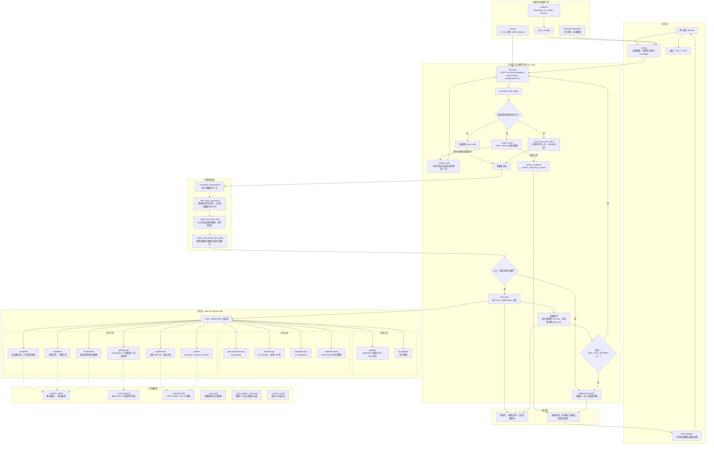

# LLM 本地文件操作 + Function Call 练习（Practice03）

基于 `Practice02` 的 `chat.py` 扩展：保留多轮对话、`getDate`、`isLeapYear` 与双模式工具调用（原生 `tool_calls` / 文本 JSON 兜底），新增 10 个本地文件操作 function call，让模型可以查询目录、读取文件、创建 / 编辑 / 删除文件与目录、重命名路径。

**代码架构图**（Mermaid 格式，纯文本）：[`chat_architecture.mmd`](chat_architecture.mmd)。可使用 [Mermaid Live Editor](https://mermaid.live)、mermaid-cli 或支持 Mermaid 的 IDE 插件渲染。

## 新增的 10 个文件操作工具

| # | 工具名 | 参数 | 说明 | 实现方式 |
| --- | --- | --- | --- | --- |
| 1 | `getCurrentDirectory` | 无 | 获取当前工作目录 | `os.getcwd()` |
| 2 | `listDirectory` | `path`、`show_hidden` | 列出目录下所有文件和子目录（大小、修改时间） | `os.scandir()` |
| 3 | `getFileType` | `path` | 获取文件类型（扩展名 / MIME / 文本或二进制） | `mimetypes` + 扩展名表 + 内容探测 |
| 4 | `readTextFile` | `path` | 读取纯文本文件内容，二进制文件拒绝读取 | 二进制探测 + UTF-8 / GBK / UTF-16 解码 |
| 5 | `createFile` | `directory`、`filename`、`content` | 在指定目录创建新文件，目录不存在时自动创建 | `os.makedirs()` + `open(..., "w")` |
| 6 | `editFile` | `path`、`content`、`mode`、`old_text`、`new_text` | 编辑纯文本文件：`overwrite` 覆盖 / `append` 追加 / `replace` 替换 | 读取 → 修改 → 按原编码写回 |
| 7 | `createDirectory` | `path` | 创建新目录（支持多级） | `os.makedirs()` |
| 8 | `deleteDirectory` | `path` | 删除目录，支持非空目录（递归删除） | `shutil.rmtree()` |
| 9 | `deleteFile` | `path` | 删除文件 | `os.remove()` |
| 10 | `renamePath` | `path`、`new_name` | 重命名文件或目录（可只改名，也可给新路径） | `os.rename()` |

原有工具保持不变：

| 工具名 | 参数 | 说明 |
| --- | --- | --- |
| `getDate` | 无 | 通过本地 `date` / `time` 命令获取系统日期时间 |
| `isLeapYear` | `year` | 用 Python 判断某年是否是闰年 |

## 文件说明

| 文件 | 说明 |
| --- | --- |
| `chat.py` | 主程序：读配置 → 多轮对话 → 工具声明 / 分发执行 → 打字机输出 |
| `chat_architecture.mmd` | 代码架构图，Mermaid 纯文本格式 |
| `config.ini` | 配置文件，`[llm]` 分区下的 `base_url` / `model` / `api_key` |

## 代码架构

架构图源文件为 [`chat_architecture.mmd`](chat_architecture.mmd)，按“交互层 → 配置与提示词 → 对话引擎 → 参数容错 → 工具层 → 工具函数层 → 输出层”分层：



各层职责：

| 层 | 关键对象 | 职责 |
| --- | --- | --- |
| 交互层 | `main()`、`print_typing()` | 读取问题、维护跨轮历史、逐字输出回答、处理 Ctrl+C / EOF |
| 配置与提示词 | `load_config()`、`config.ini`、`SYSTEM_PROMPT`、`TOOLS` | 读取接口配置；约束模型必须先用工具；声明 12 个 function call |
| 对话引擎 | `run_turn()`、`ask_llm()`、`normalize_tool_calls()` | 发起非流式请求、识别工具调用、循环执行直到拿到最终回答 |
| 参数容错 | `_normalize_arguments()`、`_infer_path_argument()`、`_repair_*()` | 补齐同义参数名 / 缺失 path，纠正指向目录或不存在的 path |
| 工具层 | `TOOL_HANDLERS` 中的 12 个 `_tool_*` / `get_date` | 真正执行文件系统与系统命令操作，返回中文结果字符串 |
| 工具函数层 | `_resolve_path()`、`_looks_binary()`、`_decode_text()` 等 | 路径解析、编码识别、二进制探测、长度裁剪等公共能力 |
| 输出层 | 控制台、最终回答 | 展示调用过程与工具结果预览；回答只依据真实工具结果 |

## 环境要求

- Python 3.8+
- 依赖库：`requests`

```bash
pip install requests
```

需要一个支持 function call（`tools` / `tool_calls`）的 OpenAI 兼容接口服务。

## 配置

编辑 `config.ini`：

```ini
[llm]
base_url = http://127.0.0.1:1234/v1
model = deepseek-r1-distill-qwen-1.5b
api_key = sk-local-dummy
```

## 运行

```bash
python chat.py
```

出现 `请输入问题：` 后输入内容并回车。相对路径**以当前工作目录为基准**，所以建议先进入 `Practice03` 目录再运行：

```text
请输入问题：当前工作目录是哪里？

[调用工具] getCurrentDirectory({})
[工具结果] 当前工作目录：F:\...\Practice02\Practice03
```

```text
请输入问题：在 demo 目录下创建 hello.txt，内容写“你好，世界”

[调用工具] createFile({"directory": "demo", "filename": "hello.txt", "content": "你好，世界"})
[工具结果] 已创建文件：F:\...\Practice03\demo\hello.txt
```

```text
请输入问题：把 hello.txt 的内容追加一行“第二行”

[调用工具] editFile({"path": "demo/hello.txt", "content": "\n第二行", "mode": "append"})
[工具结果] 已追加内容：F:\...\Practice03\demo\hello.txt（新增 4 个字符）
```

```text
请输入问题：把 hello.txt 重命名为 hi.txt，然后列出 demo 目录

[调用工具] renamePath({"path": "demo/hello.txt", "new_name": "hi.txt"})
[工具结果] 已将文件重命名：...\demo\hello.txt -> ...\demo\hi.txt

[调用工具] listDirectory({"path": "demo"})
[工具结果] 目录：...\demo
共 1 项（目录在前）：
[文件] hi.txt（...）
```

删除非空目录：

```text
请输入问题：删除 demo 目录

[调用工具] deleteDirectory({"path": "demo"})
[工具结果] 已删除目录：...\demo（其中 1 个文件、0 个子目录）
```

> PowerShell 控制台若出现中文乱码，先执行 `chcp 65001` 再运行。

## 实现要点

- **工具定义**：`TOOLS` 按 OpenAI function call 规范声明 12 个工具，参数、类型、必填项、`mode` 枚举都写清楚，降低小模型传错参数的概率。
- **纯文本限制**：`readTextFile` / `editFile` 先做二进制探测（BOM、NUL 字节、控制字符比例），再用 UTF-8 / GBK / UTF-16 解码；编辑时按原编码写回，避免破坏中文文件。
- **路径基准**：相对路径统一由 `_resolve_path()` 基于 `os.getcwd()` 转成绝对路径，工具结果里返回绝对路径，便于模型和用户确认。Windows 上模型常把 `test.md` 写成 `/test.md`（会被当成盘符根目录），若盘符根下不存在、而当前目录下同名文件存在，会自动按相对路径处理。
- **按试用要求放开限制**：`editFile`、`deleteDirectory`、`deleteFile`、`renamePath` 不再做路径安全限制，可以操作当前目录、上级目录等任意可访问路径；`_assert_safe_target()` 仍保留在代码中但已停用。请勿在生产环境或重要目录中随意试用。
- **多步文件操作**：`MAX_TOOL_ROUNDS = 8`，支持“建目录 → 建文件 → 写内容 → 读回验证”这类多步任务；同一轮内完全相同的调用只执行一次，连续两轮完全相同的调用直接收尾，防止模型原地打转。
- **参数容错**：`_normalize_arguments()` 兼容小模型常用的 `filename`、`file_path`、`directory` 等同义参数名；若 `path` 直接缺失（例如 `readTextFile({})`），会先用问题里唯一出现的文件名补齐，再回退到本轮上一次成功的路径（控制台打印 `[参数修正]`）；`_repair_file_path_call()` 在“问题里只有一个文件名、但模型把 `path` 写成 `./` 或目录”时自动修正，多个文件名时不猜测，避免误删。
- **双模式工具调用**：原生 `tool_calls` 按 OpenAI 规范以 `role="tool"` 回传；小模型输出的文本 JSON（含全角引号、一次多个 JSON）会被解析，以 `【工具执行结果】` 的 user 消息回传。
- **漏调兜底**：问题命中“列目录 / 读文件 / 删除 / 重命名”等关键词但模型没有调用工具时，自动追问一次并给出调用示例；达到调用上限或模型反复调用时，直接用最后一次工具结果作为回答。
- **异常处理**：文件不存在、类型不符、编码无法识别、权限不足、参数错误等都会转成中文字符串回传给模型，程序不会崩溃。

## 常见问题

| 现象 | 处理方式 |
| --- | --- |
| `HTTP 错误 400` 并提示 `tools` 不支持 | 所连模型或服务不支持 function call，换支持工具调用的模型 |
| 模型始终不调用工具 | 换用支持 `tool_calls` 的模型，或在提问中明确“用工具查看 / 创建 / 删除” |
| `xxx 工具执行失败：不是纯文本文件` | 读取 / 编辑只支持纯文本；二进制文件请用 `getFileType` 查看类型 |
| `deleteDirectory` / `deleteFile` 删除了重要文件 | 试用版本已按需求停用路径安全限制，删除 / 重命名前务必确认当前目录和绝对路径 |
| `deleteFile` 的 `path` 是 `./` 或目录 | 新版会自动用问题中的唯一文件名修正，并打印 `[参数修正]`；若问题里有多个文件名，请明确写出要删除的那一个 |
| `readTextFile 工具执行失败：缺少必填参数：path` | 模型漏写了 `path`。新版会用问题中的文件名、或本轮上一次成功操作的路径自动补齐（打印 `[参数修正]`）；若问题里没有任何文件名，请明确写出要读取的文件，例如“读取 test.md” |
| 读取当前目录的 `test.md` 却提示 `文件不存在：F:\test.md` | 模型把相对路径写成了 `/test.md`，被当成盘符根目录；新版在当前目录存在同名文件时会自动按相对路径处理 |
| `文件不存在` / `目录不存在` | 用 `getCurrentDirectory` / `listDirectory` 确认相对路径基准和实际文件名 |
| `请求超时（120s）` | 调小 `TIMEOUT` 或换更快的本地模型；若本地模型长时间无响应，检查推理服务状态 |
| `网络请求失败` | 接口服务未启动或端口不通，先确认服务状态 |
