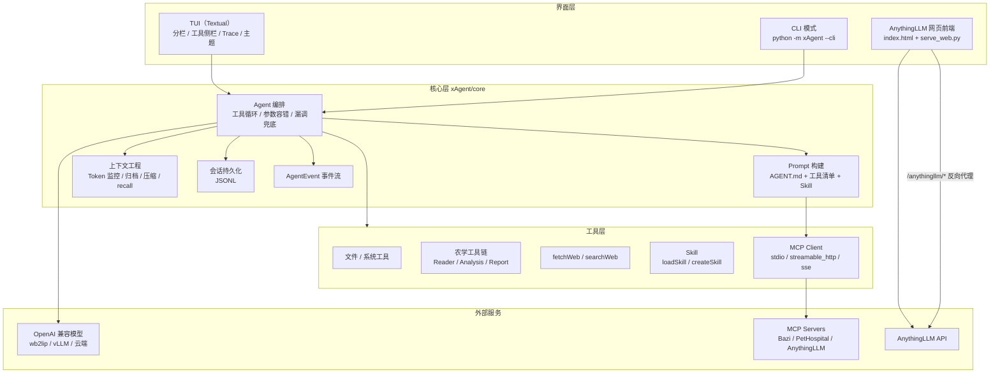
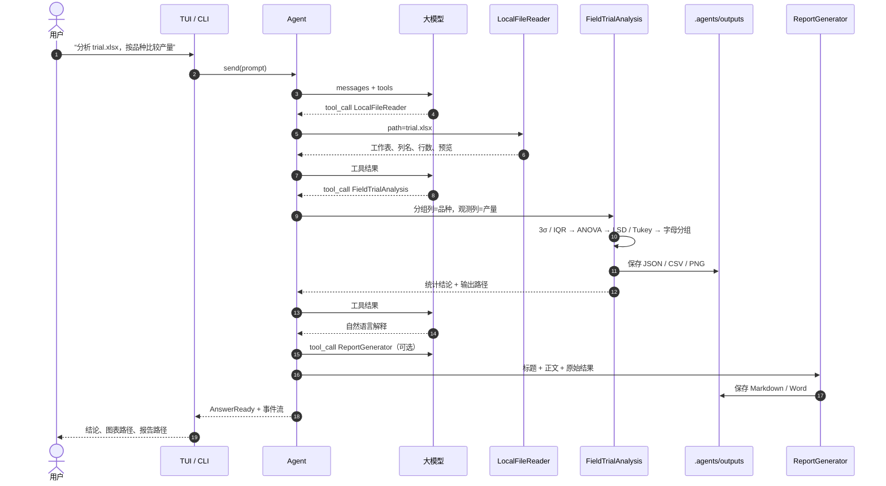
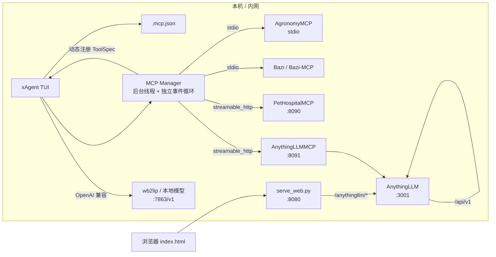

# 耕云 · 智能化农学田间试验辅助（xAgent）

> 面向农学田间试验的本地智能体：用自然语言驱动文件、统计、绘图与报告工具，
> 数据不出内网，分析过程可复现，结果可追溯。

- **作品名称**：耕云——智能化农学田间试验辅助
- **技术底座**：xAgent（core / TUI 分离） + OpenAI 兼容大模型 + MCP 热插拔
- **运行形态**：TUI 终端界面 + AnythingLLM 简易网页前端
- **数据边界**：默认全部在本地完成；只有用户显式调用 `fetchWeb` / `searchWeb` 时才访问公网

---

## 一、开发背景

农学田间试验是品种选育、栽培措施验证和施肥方案比较的基础工作。一个完整的试验周期通常包含：

1. 田间设计（完全随机、随机区组、裂区等）与重复设置；
2. 小区取样、考种、测产，形成 CSV / Excel 原始数据；
3. 异常值检查、描述统计、方差分析、多重比较与显著性字母分组；
4. 形成图表、结论和规范报告，供课题组或生产部门使用。

在实际教学与科研场景中，这条链路往往被拆散在 Excel、SPSS、R、Python 脚本和 Word 之间：

- 软件切换频繁，统计参数容易记错；
- 分析步骤依赖个人经验，学生难以复现；
- 原始数据需要上传到在线平台，存在隐私与合规风险；
- 报告写作重复劳动多，统计结果与文字结论容易不一致。

与此同时，大模型已经具备理解自然语言、调用工具和解释统计结果的能力。我们希望把“会写代码的助手”变成“懂田间试验流程的助手”：不仅能回答问题，还能真正读取试验数据、执行统计检验、保存图表并生成报告。

「耕云」因此诞生。名字取“耕耘”与“云”的结合：**扎根田间，用智能体把试验数据变成可用的结论**。

---

## 二、拟解决的问题

| 问题 | 耕云的做法 |
| --- | --- |
| 不会写统计脚本，Excel 公式易错 | 用自然语言描述分组列和观测列，自动完成异常值检测、ANOVA、LSD / Tukey 与字母分组 |
| 分析步骤不可复现 | 所有中间结果保存为 CSV / JSON，报告记录生成时间与工具链，可回查 |
| 数据不敢上传公网 | 默认本地运行；文件读取、统计、绘图、报告均在项目目录内完成 |
| 多软件来回切换 | 一个对话窗口内完成“读数据 → 分析 → 解释 → 生成报告” |
| 报告写作耗时 | `ReportGenerator` 直接输出 Markdown / Word，并支持附加原始分析结果 |
| 工具扩展困难 | MCP 热插拔 + `AGENT.md` 长期规则 + 自动生成工具提示词，新能力无需改界面 |
| 上下文容易超限 | Token 监控、归档、压缩摘要与 `recallContext` 检索组成完整的上下文工程 |
| 网页端密钥泄露风险 | 本地 `serve_web.py` 反向代理，服务端从 `.env` 读取密钥，浏览器不接触 API Key |

---

## 三、核心功能

### 3.1 多轮对话与工具编排

- **OpenAI 兼容接口**：可连接 wb2lip 本地模型、vLLM、Ollama（OpenAI 兼容层）或云端服务。
- **Function Calling 工具循环**：模型自主选择工具，xAgent 执行后把结果回传，最多 `max_tool_rounds` 轮。
- **参数容错**：同义参数名归一化、缺失路径补齐、路径指向目录时自动修正、编造路径修正。
- **漏调兜底**：用户明确要求“搜索 / 读取 / 列出”但模型未调用工具时，自动追问一次。
- **原地打转检测**：连续两轮完全相同的工具调用会停止循环并返回最近一次结果。
- **事件流接口**：`Agent.send()` 产出 `AgentEvent`，TUI 与 Web 都只消费事件，核心与界面解耦。

### 3.2 农学田间试验工具链（本次新增）

| 工具 | 能力 | 默认输出 |
| --- | --- | --- |
| `LocalFileReader` | 读取 CSV / TSV / Excel，自动识别分隔符、工作表、重复列名，返回列名、行数和前 N 行预览 | 对话内预览 |
| `PythonCodeInterpreter` | 在 `.agents/sandbox` 隔离子进程中执行 Python，限定工作目录、超时终止、输出截断，适合 pandas / numpy 自定义清洗 | 退出码、stdout、stderr、新增文件 |
| `FieldTrialAnalysis` | 按分组列自动分组；3σ / IQR 异常值检测；单因素 ANOVA；LSD 与 Tukey HSD；显著性字母分组 | `.agents/outputs/*.json`、`*_groups.csv`、`*.png` |
| `ReportGenerator` | 把 Markdown 正文生成 Markdown 或 Word 报告，可附加原始分析结果 | `.agents/outputs/report_*.md` / `.docx` |

**统计实现说明**：

- 统计计算使用 Python 标准库实现，不强制依赖 scipy；
- F 分布上尾概率通过正则化不完全 Beta 函数计算；
- LSD 的 t 临界值用二分法求解；
- Tukey HSD 的 q 临界值使用 α=0.05 的学生化极差表插值（无 scipy 时的近似方案）；
- 显著性字母分组基于 Tukey 两两比较结果生成；
- 安装 `openpyxl` 后可读 Excel，安装 `matplotlib` 后可绘图，安装 `python-docx` 后可导出 Word；缺少这些包时会给出明确提示或跳过绘图，不会导致分析中断。

### 3.3 文件与系统工具

- `getCurrentDirectory`、`listDirectory`、`getFileType`、`readTextFile`
- `createFile`、`editFile`（overwrite / append / replace）
- `createDirectory`、`deleteDirectory`
- `deleteFile`（默认只删文件；删除目录必须显式 `recursive=true`）
- `moveFile`（移动 / 重命名，跨磁盘自动复制后删除，默认不覆盖）
- `renamePath`
- `getDate`、`getCurrentTime`（星期、ISO 周、季度、闰年、每月天数、日期合法性校验）
- `isLeapYear`

### 3.4 网页抓取与搜索

- `fetchWeb`：调用本地 `curl` 下载网页，再用 `trafilatura` 提取 Markdown 正文；对 401 / 403 等情况返回可解释的错误并降级。
- `searchWeb`：百度千帆 AI 搜索，返回标题、链接、来源、时间和摘要。

### 3.5 上下文工程

- **Token 监控**：启动时探测模型窗口，达到 `context_warn_ratio` 后暂停普通提问；
- **原文归档**：压缩前把完整对话写入 `.agents/context/*.jsonl`；
- **压缩摘要**：只调用一次不带工具的 LLM 生成摘要，成功后替换历史；
- **`recallContext`**：在归档中做关键词检索，压缩后仍能找回细节；
- **JSONL 会话**：自动保存、列出、恢复，支持 `/new`、`/save`、`/resume`、`/compact`、`/context`、`/tools` 等命令。

### 3.6 MCP 热插拔

- 支持 `stdio`、`streamable_http`、`sse` 三种传输；
- 启动后后台连接 `.mcp.json` 中的 Server，动态注册工具，不阻塞界面；
- 单个 Server 失败不影响其他 Server 与本地工具；
- 原有 `Bazi`、`Bazi-MCP`、`PetHospitalMCP`、`AnythingLLMMCP` 配置保持不变；
- 本次新增 `AgronomyMCP` stdio 示例，默认 `"enabled": false`，按需开启。

### 3.7 双前端

- **TUI**：分栏布局、右侧工具 / 命令 / Trace 面板、主题切换、Token 状态条、上下文压缩预览；
- **网页前端**：根目录 `index.html`，原生 JavaScript，通过 `fetch` 调用 AnythingLLM；
  密钥由本地 `serve_web.py` 从 `.env` 读取并在服务端注入，浏览器不接触 API Key。

### 3.8 `AGENT.md` 长期规则注入

- 启动时自动检测项目根目录的 `AGENT.md`（单数）；
- 存在则读取全部内容，放在 **System Prompt 最前端**；
- 不存在、为空或不可读时静默跳过，不影响启动；
- 规则不进入聊天历史，因此不会被上下文压缩摘要；
- 与原有 `AGENTS.md`（复数，会话级项目说明，只注入一次）并存，互不替代。

---

## 四、系统架构

### 图 1：总体分层架构



**说明**：核心层不依赖 Textual；TUI、CLI、网页前端都是可替换的“壳”。工具分为本地工具、农学工具、Skill 与 MCP 动态工具，统一注册到 `ToolRegistry`，由 Prompt 自动生成工具声明。

### 图 2：一次田间试验分析的数据流



**说明**：模型只负责“决定调用哪个工具、如何解释结果”，真正的数值计算在本地 Python 中完成。所有输出写入 `.agents/outputs`，便于复现与答辩演示。

### 图 3：MCP 热插拔与部署拓扑



**说明**：MCP Server 连接失败只影响自身，不影响本地工具；`AgronomyMCP` 默认关闭，开启后与内置农学工具使用同一套实现，避免“两套逻辑”。网页前端通过 `serve_web.py` 代理 AnythingLLM，服务端注入密钥，浏览器不保存密钥。

---

## 五、目录结构

```text
xAgent/
├── __main__.py                 # 入口：python -m xAgent（TUI）或 --cli
├── AGENT.md                    # 智能体长期规则（启动时前置注入系统提示词）
├── index.html                  # AnythingLLM 简易网页前端（原生 JS）
├── serve_web.py                # 本地静态服务 + AnythingLLM 反向代理（.env 读取密钥）
├── .env.example                # 网页前端配置模板（复制为 .env）
├── config.ini                  # 模型、上下文、农学工具等配置
├── .mcp.json                   # MCP Server 配置（含默认关闭的 AgronomyMCP）
├── requirements.txt
├── README.md
├── core/                       # 核心业务逻辑（界面无关）
│   ├── agent.py                # 多轮对话、工具循环、参数容错、AGENT.md 注入
│   ├── agent_rules.py          # AGENT.md 读取、截断、哈希与 Prompt 包装
│   ├── agents_md.py            # AGENTS.md 会话级项目说明
│   ├── config.py               # 配置读取与首次运行生成
│   ├── context.py              # Token 监控、归档、压缩摘要
│   ├── events.py               # AgentEvent 事件对象
│   ├── prompts.py              # 根据工具注册表自动生成系统提示词
│   ├── recovery.py             # 参数容错与漏调追问
│   ├── session.py              # JSONL 会话保存 / 恢复
│   ├── skills.py               # Skill 发现与 loadSkill / createSkill
│   ├── llm/                    # OpenAI 兼容客户端与消息构造
│   ├── mcp/                    # MCP 配置、连接、工具映射
│   ├── tools/
│   │   ├── files.py            # 11 个文件工具（含 deleteFile / moveFile）
│   │   ├── system.py           # getDate / getCurrentTime / isLeapYear
│   │   ├── agronomy.py         # 农学工具链（本次新增）
│   │   ├── web.py              # fetchWeb
│   │   ├── search.py           # searchWeb
│   │   ├── recall.py           # recallContext
│   │   └── cli.py              # RunCli
│   └── utils/
├── tui/                        # Textual 界面
├── mcp_servers/
│   └── agronomy_mcp_server.py  # 农学 MCP Server（stdio，默认关闭）
└── tests/                      # 离线单元测试 + 可选联网冒烟测试
```

---

## 六、快速开始

### 6.1 环境要求

- Windows / Linux / macOS；
- Python **3.10+**（当前验证环境为 Windows + Python 3.10.11 32 位）；
- 可选：`pandas`、`numpy`、`matplotlib`、`openpyxl`、`python-docx`（Excel / 绘图 / Word 导出）；
- 可选：AnythingLLM（网页前端）；
- 可选：wb2lip 或其它 OpenAI 兼容本地推理服务。

### 6.2 安装依赖

```powershell
cd F:\xie_teacher_documents\anything-LLM-web\LLM-Course\Agent
python -m pip install -r xAgent\requirements.txt
```

农学增强依赖（按需）：

```powershell
python -m pip install pandas numpy matplotlib openpyxl python-docx
```

### 6.3 配置模型

编辑 `Agent\config.ini`（从父目录启动）或 `Agent\xAgent\config.ini`（从 xAgent 目录启动）：

```ini
[llm]
base_url = http://127.0.0.1:7863/v1
model = cn:hy4-preview-f
api_key = sk-你的密钥
timeout = 300
temperature = 0.2
context_window = 0
```

首次在其它目录运行且没有 `config.ini` 时，xAgent 会自动生成一份带 mock 值的配置并提示修改。

### 6.4 启动 TUI

```powershell
cd F:\xie_teacher_documents\anything-LLM-web\LLM-Course\Agent
python -m xAgent
```

启动后可看到：

- 左侧对话区、右侧工具 / 命令 / Trace 侧栏；
- “已加载长期规则 AGENT.md …” 提示（存在 `AGENT.md` 时）；
- 底部 Token 使用量与模型窗口；
- 输入 `/` 弹出斜杠命令补全。

### 6.5 启动 CLI

```powershell
cd F:\xie_teacher_documents\anything-LLM-web\LLM-Course\Agent
python -m xAgent --cli
```

### 6.6 启动网页前端

1. 复制配置模板并填写真实密钥：

   ```powershell
   cd F:\xie_teacher_documents\anything-LLM-web\LLM-Course\Agent\xAgent
   Copy-Item .env.example .env
   notepad .env
   ```

   ```ini
   ANYTHINGLLM_BASE_URL=http://localhost:3001
   ANYTHINGLLM_API_KEY=你的-AnythingLLM-API-Key
   ANYTHINGLLM_WORKSPACE=default
   XAGENT_WEB_HOST=127.0.0.1
   XAGENT_WEB_PORT=8080
   ```

2. 检查配置（密钥脱敏显示）：

   ```powershell
   python serve_web.py --check
   ```

3. 启动服务：

   ```powershell
   python serve_web.py
   ```

4. 浏览器访问 `http://127.0.0.1:8080/`，选择工作区后开始对话。

> 网页前端只负责 AnythingLLM 对话；田间试验的数据读取、统计和报告生成请在 xAgent TUI 中使用，以避免在浏览器里传输原始数据。

---

## 七、农学统计方法说明

### 7.1 异常值检测

- **3σ 法**：对每组计算均值与样本标准差，`|x - mean| > 3s` 视为异常；要求每组至少 3 个观测。
- **IQR 法**：`Q1 - 1.5×IQR` 与 `Q3 + 1.5×IQR` 之外视为异常；要求每组至少 4 个观测。
- 默认 `outlier_method = both`，两种方法命中的观测取并集后剔除；
- 报告中会列出行号、原始值和判定方法；
- 也可选择 `none` 保留全部数据，便于对照。

### 7.2 单因素方差分析（ANOVA）

对 k 个分组、总观测数 N：

- 组间平方和 `SS_between = Σ n_i (mean_i - grand_mean)²`
- 组内平方和 `SS_within = Σ Σ (x_ij - mean_i)²`
- `F = MS_between / MS_within`
- p 值由 F 分布上尾概率计算；
- 同时输出 `η² = SS_between / SS_total` 作为效应量参考。

### 7.3 多重比较

- **LSD**：`LSD = t(α/2, df_within) × sqrt(MSE × (1/n_a + 1/n_b))`，差值绝对值大于 LSD 判为显著；
- **Tukey HSD**：`q = |mean_a - mean_b| / sqrt(MSE/2 × (1/n_a + 1/n_b))`，与 q 临界值比较；
- 无 scipy 时 q 临界值使用 α=0.05 表插值，报告中明确标注“近似”；
- **显著性字母分组**：均值从高到低排序，Tukey 不显著的组归入同一字母桶；字母不同表示差异显著。

### 7.4 使用边界

- `FieldTrialAnalysis` 目前实现的是**单因素**方差分析；随机区组、裂区、双因素等多因素设计需要先用 `PythonCodeInterpreter` 做自定义建模；
- 统计检验要求观测独立、方差齐性、近似正态；不满足时应改用非参数方法或数据变换；
- 异常值剔除必须有农学依据，不能只看统计阈值；
- 结论受年份、地点、栽培条件和重复数影响，不能直接外推到所有生产场景。

---

## 八、工具清单

默认注册 **22 个本地工具**；`Agent` 初始化时再注册 `loadSkill` 与 `createSkill`，合计 **24 个**。MCP 工具在此基础上动态追加。

| 类别 | 工具 | 说明 |
| --- | --- | --- |
| 文件 | `getCurrentDirectory` | 当前工作目录 |
| 文件 | `listDirectory` | 列出目录内容（大小、修改时间） |
| 文件 | `getFileType` | 扩展名 / MIME / 文本或二进制 |
| 文件 | `readTextFile` | 读取纯文本（二进制拒绝） |
| 文件 | `createFile` | 创建文件（自动建目录） |
| 文件 | `editFile` | overwrite / append / replace |
| 文件 | `createDirectory` | 创建多级目录 |
| 文件 | `deleteDirectory` | 递归删除目录 |
| 文件 | `deleteFile` | 删除文件；目录需 `recursive=true` |
| 文件 | `moveFile` | 移动 / 重命名；跨磁盘自动复制后删除 |
| 文件 | `renamePath` | 重命名文件或目录 |
| 系统 | `getDate` | 通过本地 `date` / `time` 命令获取时间 |
| 系统 | `getCurrentTime` | 标准库时间、星期、ISO 周、季度、闰年、日期校验 |
| 系统 | `isLeapYear` | 闰年判断 |
| 网页 | `fetchWeb` | curl + trafilatura 提取网页正文 |
| 搜索 | `searchWeb` | 百度千帆 AI 搜索 |
| 命令 | `RunCli` | 参数列表方式执行本地命令，超时终止、输出截断 |
| 农学 | `LocalFileReader` | 读取 CSV / TSV / Excel |
| 农学 | `PythonCodeInterpreter` | `.agents/sandbox` 内执行 Python |
| 农学 | `FieldTrialAnalysis` | 异常值 + ANOVA + LSD / Tukey + 字母分组 |
| 农学 | `ReportGenerator` | 生成 Markdown / Word 报告 |
| 上下文 | `recallContext` | 检索 `.agents/context/*.jsonl` 归档 |
| Skill | `loadSkill` | 按需加载 Skill 正文与附件 |
| Skill | `createSkill` | 创建新 Skill（立即刷新系统提示词） |

---

## 九、MCP 配置模板

xAgent 从当前项目目录向上查找 `.mcp.json`，也支持环境变量 `XAGENT_MCP_CONFIG` 指定路径。

### 9.1 农学 MCP（stdio，默认关闭）

`Agent\xAgent\.mcp.json`：

```json
{
  "mcpServers": {
    "AgronomyMCP": {
      "type": "stdio",
      "command": "python",
      "args": ["mcp_servers/agronomy_mcp_server.py"],
      "cwd": ".",
      "timeout": 120,
      "connect_timeout": 30,
      "enabled": false,
      "description": "耕云农学田间试验 MCP Server（stdio，默认关闭）。需要时把 enabled 改为 true。"
    }
  }
}
```

从父目录 `Agent\` 启动时，`cwd` 改为 `"xAgent"`：

```json
{
  "mcpServers": {
    "AgronomyMCP": {
      "type": "stdio",
      "command": "python",
      "args": ["mcp_servers/agronomy_mcp_server.py"],
      "cwd": "xAgent",
      "enabled": false
    }
  }
}
```

启用步骤：

1. 把 `"enabled": false` 改为 `true`；
2. 在 xAgent 目录执行 `python mcp_servers/agronomy_mcp_server.py` 可先单独验证（应看到启动日志，Ctrl+C 退出）；
3. 重启 xAgent，`/mcp` 查看连接状态，`/tools` 查看新增工具。

`AgronomyMCP` 暴露 4 个工具：`ReadFieldData`、`AnalyzeFieldTrial`、`RunPythonSandbox`、`GenerateTrialReport`。

### 9.2 远程 Streamable HTTP 示例

```json
{
  "mcpServers": {
    "PetHospitalMCP": {
      "type": "streamable_http",
      "url": "http://127.0.0.1:8090/mcp",
      "timeout": 60,
      "connect_timeout": 10
    }
  }
}
```

### 9.3 自动拉起本地服务（可选）

```json
{
  "autoStart": {
    "command": "powershell",
    "args": [
      "-NoProfile",
      "-ExecutionPolicy",
      "Bypass",
      "-File",
      "start_mcp_servers.ps1"
    ],
    "cwd": ".",
    "timeout": 180
  }
}
```

原有的 `Bazi`、`Bazi-MCP`、`PetHospitalMCP`、`AnythingLLMMCP` 与 `autoStart` 配置不变；`AgronomyMCP` 为默认关闭的追加项。

---

## 十、wb2lip 本地模型部署说明

xAgent 只要求模型服务提供 **OpenAI 兼容接口**。wb2lip 作为本地模型服务部署时，按下面步骤接入：

### 10.1 启动 wb2lip 服务

1. 按 wb2lip 的官方说明安装运行环境与模型权重；
2. 启动 OpenAI 兼容服务，使其监听本机端口（当前配置使用 `7863`）；
3. 确认服务暴露 `/v1/chat/completions` 与 `/v1/models`。

具体启动命令以所用 wb2lip 版本为准；关键是最终提供一个形如
`http://127.0.0.1:7863/v1` 的 OpenAI 兼容地址。

### 10.2 验证服务

```powershell
curl http://127.0.0.1:7863/v1/models
```

应返回模型列表。当前配置使用的模型名为：

```text
cn:hy4-preview-f
```

如果 `/models` 返回的名称不同，请以实际返回值为准修改 `config.ini`。

### 10.3 配置 xAgent

```ini
[llm]
base_url = http://127.0.0.1:7863/v1
model = cn:hy4-preview-f
api_key = sk-C-VlOMREnaSer9s3fIGKgE-E
timeout = 300
temperature = 0.2
context_window = 0
```

- `api_key` 可以是本地服务约定的任意占位值；请勿把真实云端密钥写入公开仓库；
- `context_window = 0` 表示先探测 `/models`，探测不到时使用 128k 默认值并在界面标注“默认”；
- 若显存有限，可把 `max_tool_rounds` 降到 4~6，减少同时携带的工具结果；
- 模型不支持 Function Calling 时，工具链路会退化为普通对话；建议选择支持工具调用的模型或推理框架。

### 10.4 启动顺序

```text
wb2lip / 本地模型（:7863） → AnythingLLM（:3001，可选） → xAgent TUI / CLI → serve_web.py（可选）
```

---

## 十一、AnythingLLM 网页前端说明

### 11.1 为什么需要 `serve_web.py`

浏览器直接调用 AnythingLLM 会遇到两个问题：

1. **CORS**：跨域请求可能被浏览器拦截；
2. **密钥暴露**：API Key 写进前端 JavaScript 后，任何访问者都能看到。

因此本项目采用“本地静态服务 + 反向代理”：

```text
浏览器  →  http://127.0.0.1:8080/anythingllm/*  →  serve_web.py  →  http://localhost:3001/api/v1/*
                                                         ↑
                                                   从 .env 注入
                                              Authorization: Bearer ***
```

### 11.2 接口

- `GET /anythingllm/config`：返回代理地址、默认工作区、是否已配置密钥（**不返回密钥**）；
- `GET /anythingllm/workspaces`：代理 AnythingLLM 工作区列表；
- `POST /anythingllm/workspace/{slug}/chat`：代理聊天接口，请求体为 `{message, mode:"chat", sessionId}`。

### 11.3 安全建议

- 默认只监听 `127.0.0.1`，不要改成 `0.0.0.0` 后直接暴露到公网；
- `.env` 已被 `.gitignore` 忽略，不要提交真实密钥；
- 若必须跨机访问，请在前面加反向代理与身份认证；
- 网页端只做对话，不上传原始试验数据。

---

## 十二、`AGENT.md` 长期规则

### 12.1 与 `AGENTS.md` 的区别

| 文件 | 作用 | 注入方式 | 是否参与压缩 |
| --- | --- | --- | --- |
| `AGENT.md`（单数） | 智能体长期固定规则 | 启动时放在 System Prompt **最前端** | 不参与，始终保留 |
| `AGENTS.md`（复数） | 项目说明 / 协作约定 | 会话首次加载时注入一条 user 消息 | 作为历史消息，压缩时保留注入消息 |

### 12.2 配置

```ini
[agent]
agent_md_filename = AGENT.md
agent_md_max_chars = 200000
```

- 文件不存在、为空或不可读时静默跳过；
- 超过 `agent_md_max_chars` 时截断并附加提示；
- 修改规则后重启 xAgent 生效；也可在代码中调用 `agent.reload_agent_rules(path)` 热重载。

---

## 十三、开发过程

1. **基线与约束梳理**
   - 阅读 core / TUI / MCP / 工具 / 会话 / 上下文代码；
   - 运行基线测试，确认原有链路可用；
   - 明确“不接硬件、不改安全沙盒限制、不破坏原有 MCP 与 TUI”。

2. **文件与系统能力补齐**
   - `deleteFile` 增加目录递归删除（显式 `recursive=true`）；
   - 新增 `moveFile`（移动 / 重命名 / 跨磁盘复制后删除 / 默认不覆盖）；
   - 新增 `getCurrentTime`（标准库时间、星期、ISO 周、季度、闰年、日期合法性校验）。

3. **规则注入**
   - 新增 `core/agent_rules.py`；
   - 启动时读取 `AGENT.md` 并前置到 System Prompt；
   - 保持 `AGENTS.md` 原有“一次注入、全程复用”逻辑不变；
   - TUI / CLI 启动时展示规则加载状态。

4. **农学能力建设**
   - 新增 `core/tools/agronomy.py`；
   - 纯 Python 实现 Beta / F / t 分布与 q 表插值，避免强依赖 scipy；
   - 实现 CSV / TSV / Excel 读取、异常值检测、ANOVA、LSD、Tukey、字母分组、CSV / JSON / PNG 输出；
   - 实现 Python 沙盒子进程与 Markdown / Word 报告生成；
   - 注册到默认工具表，并同步到 MCP Server。

5. **网页前端**
   - 新增 `index.html`（原生 JS，无构建步骤）；
   - 新增 `serve_web.py`（标准库 HTTP 服务 + 反向代理 + `.env` 读取）；
   - 新增 `.env.example`，`.gitignore` 忽略 `.env`；
   - 前端从 `/anythingllm/config` 获取代理信息，不接触密钥。

6. **测试与文档**
   - 新增文件工具、时间工具、`AGENT.md` 注入、农学统计、沙盒、报告、注册表测试；
   - `py_compile` 全量检查；
   - 完整 unittest 回归；
   - 重写 README，使文档与代码真实能力一致。

---

## 十四、测试与验证

### 14.1 语法检查

```powershell
cd F:\xie_teacher_documents\anything-LLM-web\LLM-Course\Agent
python -m py_compile xAgent\core\tools\agronomy.py xAgent\core\agent_rules.py xAgent\serve_web.py xAgent\mcp_servers\agronomy_mcp_server.py
```

### 14.2 新增能力测试

```powershell
cd F:\xie_teacher_documents\anything-LLM-web\LLM-Course\Agent
python -m unittest xAgent.tests.test_agronomy_tools -v
```

覆盖：

- `deleteFile` 默认只删文件、目录需 `recursive=true`；
- `moveFile` 移动、重命名、拒绝覆盖；
- `getCurrentTime` 合法 / 非法日期、星期、ISO 周、季度；
- `AGENT.md` 前置注入与缺失时不报错；
- CSV 预览、ANOVA / LSD / Tukey / 字母分组、JSON / CSV 输出；
- Python 沙盒执行与 Markdown 报告；
- 新工具注册表检查。

### 14.3 完整回归

```powershell
cd F:\xie_teacher_documents\anything-LLM-web\LLM-Course\Agent
python -m unittest discover -s xAgent/tests -t . -q
```

预期：全部通过；联网 / MCP 冒烟测试在无服务时自动跳过。

### 14.4 MCP Server 自检

```powershell
cd F:\xie_teacher_documents\anything-LLM-web\LLM-Course\Agent\xAgent
python -c "import sys, asyncio; sys.path.insert(0,'.'); import mcp_servers.agronomy_mcp_server as s; print(asyncio.run(s.server.list_tools()))"
```

应列出 `ReadFieldData`、`AnalyzeFieldTrial`、`RunPythonSandbox`、`GenerateTrialReport`。

### 14.5 网页服务自检

```powershell
cd F:\xie_teacher_documents\anything-LLM-web\LLM-Course\Agent\xAgent
python serve_web.py --check
python serve_web.py
```

浏览器访问 `http://127.0.0.1:8080/`；`GET /anythingllm/config` 应返回 `hasApiKey` 与默认工作区。

---

## 十五、应用成效

在课程演示与本地测试中，耕云已经形成一条完整的“试验数据 → 统计结论 → 报告”闭环：

1. **降低使用门槛**：用户不需要写 Python 或记 SPSS 菜单，用自然语言说明分组列与观测列即可完成单因素分析。
2. **提升可复现性**：每次分析都输出 JSON / CSV / PNG，报告带生成时间与工具链信息，便于复盘与答辩。
3. **减少软件切换**：读取、统计、解释、报告在同一个对话窗口完成。
4. **数据更安全**：默认本地运行；网页端密钥由服务端注入，浏览器不接触 API Key。
5. **扩展成本低**：新增工具只需注册 `ToolSpec`；MCP Server 可热插拔；`AGENT.md` 让领域规则与代码解耦。
6. **教学价值**：统计结果会同时给出 n、均值、标准差、F、p、LSD / Tukey 与字母分组，便于教师讲解“为什么这样判显著”。

> 说明：上述成效来自功能验证与课程演示，不包含生产环境的大规模对照试验数据；实际推广前需要更多年份、地点和作物类型的验证。

---

## 十六、风险与边界

### 16.1 统计风险

- `FieldTrialAnalysis` 只实现单因素 ANOVA；多因素、随机区组、裂区设计需自定义代码；
- Tukey q 临界值在无 scipy 时使用查表 + 插值，属于近似值，报告已标注；
- 3σ / IQR 是统计筛选，不是农学判废依据；
- 方差不齐或非正态时，F 检验与多重比较结果可能不可靠；
- 小样本（每组 n < 3）无法可靠做异常值检测与方差分析。

### 16.2 工程风险

- `PythonCodeInterpreter` 是**目录级隔离 + 超时 + 输出截断**，不是操作系统级沙盒；
- 文件工具按“试用版本”设计，不做路径白名单；请勿在重要目录上执行删除 / 覆盖操作；
- 删除目录必须显式 `recursive=true`，但仍建议先备份；
- `serve_web.py` 默认只监听 `127.0.0.1`，不要直接暴露公网；
- `.env` 含真实密钥，已被 `.gitignore` 忽略，请勿手动提交；
- MCP Server 是外部进程，其行为与安全性由对应 Server 负责；
- 大模型可能生成不准确的统计解释，最终结论应由专业人员复核。

### 16.3 模块稳定性标注

| 模块 | 状态 | 说明 |
| --- | --- | --- |
| MCP Client（stdio / streamable_http / sse） | **原有稳定模块** | 本次仅追加默认关闭的 `AgronomyMCP` 示例，未改连接逻辑 |
| TUI 分栏 / 侧栏 / 主题 / Token 状态 | **原有稳定模块** | 仅增加一行 `AGENT.md` 加载提示 |
| 上下文压缩 / JSONL 会话 / `recallContext` | **原有稳定模块** | 未改压缩与归档逻辑 |
| 文件工具 | **原有稳定模块（有扩展）** | `deleteFile` 增加目录能力，新增 `moveFile` |
| `fetchWeb` / `searchWeb` | **原有稳定模块** | 未改 401/403 容错与降级逻辑 |
| wb2lip 本地模型链路 | **原有稳定模块** | 仅文档说明，未改客户端 |
| `AGENT.md` 注入 | **本次新增** | 新增 `core/agent_rules.py` 与启动接入 |
| 农学工具链 | **本次新增** | `core/tools/agronomy.py`、4 个工具、MCP Server |
| 网页前端与代理 | **本次新增** | `index.html`、`serve_web.py`、`.env` |
| `getCurrentTime` | **本次新增** | `core/tools/system.py` |

---

## 十七、结语

耕云不是要把农学研究者变成程序员，而是把重复、易错、难复现的分析步骤交给智能体，把判断与决策留给研究者。

它保留了 xAgent 已经跑通的 MCP、TUI、上下文工程与本地模型链路，在此基础上补齐了农学统计、文件操作、长期规则和网页入口。我们希望它既能作为课程中的可运行作品，也能作为后续扩展的底座：接更多试验设计、接更多作物模型、接更多科室的实际数据规范。

**耕云，让每一份田间数据都能被读懂、被复现、被用起来。**
